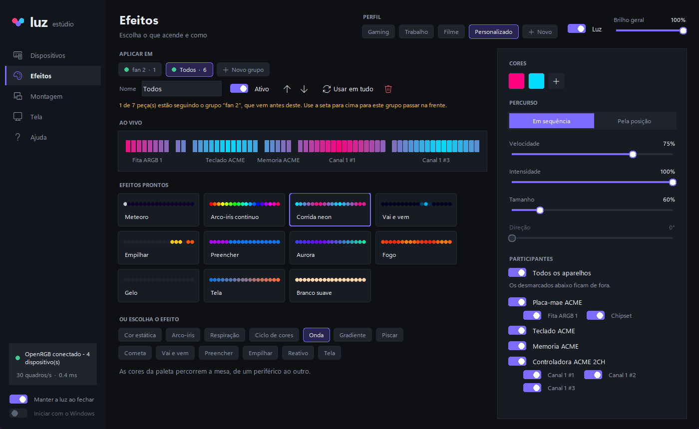
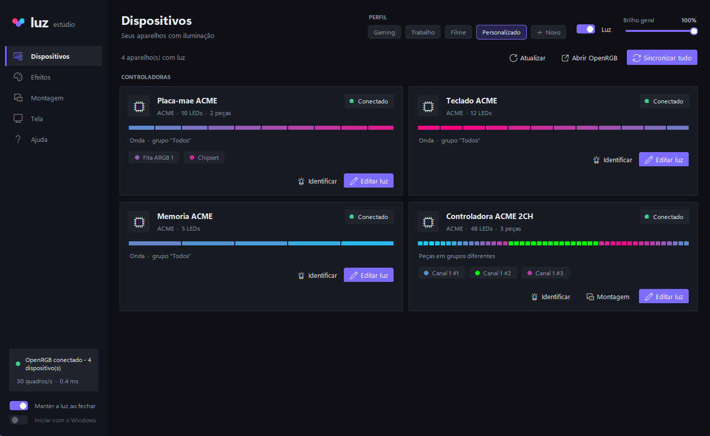
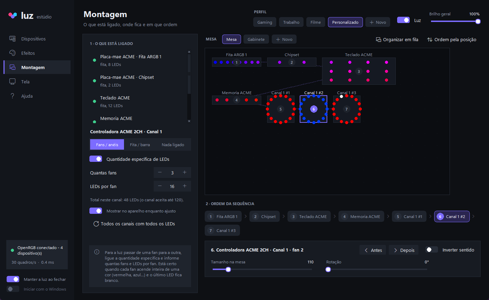

<p align="center">
  
</p>

<h1 align="center">VYRA — Unified Lighting</h1>

<p align="center">
  Controle a iluminação RGB de todo o seu PC em um só lugar, de forma leve.<br>
  Efeitos que passam de um periférico para o outro, ambilight com as cores da tela e perfis de um clique.
</p>

<p align="center">
  
</p>

---

## Por que o VYRA

Programas como o SignalRGB são completos, mas pesam no PC. O VYRA faz o essencial gastando pouco:
cerca de **20 MB de memória** e **1 a 3% de um núcleo** com um efeito animado rodando.

- **Tudo sincronizado** — teclado, mouse, memória, fans, fitas e placa-mãe no mesmo efeito.
- **Efeitos em sequência** — a luz sai de uma fan e entra na próxima, na ordem que você escolher.
- **Mesa virtual** — posicione cada peça como ela está no seu setup; os efeitos respeitam essa posição.
- **Tela (ambilight)** — os LEDs acompanham as cores do que está na tela.
- **Grupos e ajustes individuais** — um efeito para tudo e outro só para uma fan, por exemplo.
- **Perfis** — Gaming, Trabalho, Filme ou os seus, trocados com um clique.
- **Continua aceso com a janela fechada** — um processo leve e sem janela mantém os efeitos.
- **Sem instalar bibliotecas** — só Python e o OpenRGB (fitas Bluetooth pedem também a `bleak`).

## Como instalar

1. **Instale o [Python 3.10 ou mais novo](https://www.python.org/downloads/)** (marque *Add Python to PATH*).
2. **Instale o [OpenRGB](https://openrgb.org)**. Ele é quem conversa com o hardware de cada fabricante.
3. **Baixe o VYRA**: botão verde **Code → Download ZIP** nesta página, e extraia numa pasta.
4. **Crie o atalho** com o ícone: dê dois cliques em `criar_atalho.py` (ou rode `python criar_atalho.py`).
   O atalho **VYRA** aparece na Área de Trabalho e no Menu Iniciar.

> Feche o SignalRGB, o iCUE, o G HUB e outros programas de RGB antes de usar: eles disputam os mesmos aparelhos.

## Primeiros passos

1. **Abra o VYRA** pelo atalho e clique em **Abrir OpenRGB**. Aceite o pedido de administrador:
   sem ele, memória RAM e placa-mãe não aparecem.
2. **Dispositivos** — confira se seus aparelhos estão como *Conectado*.
3. **Montagem** — se você tem fans ARGB numa controladora, informe quantas fans e quantos LEDs
   por fan em cada canal. Cada fan acende de uma cor enquanto você ajusta; está certo quando
   cada uma fica inteira de uma cor só.
4. **Efeitos** — escolha um efeito pronto. Pronto: pode fechar a janela, a luz continua.

<p align="center">
  
  
</p>

## As páginas

| Página | Para quê |
|---|---|
| **Dispositivos** | Seus aparelhos, a cor de cada um no momento e o efeito que está valendo |
| **Efeitos** | Efeitos prontos, cores, velocidade e quais aparelhos participam |
| **Montagem** | Quantos LEDs há em cada canal, posição das peças na mesa e ordem da sequência |
| **Tela** | Ajustes do ambilight: quadros por segundo, suavização e vivacidade |
| **Ajuda** | Dicas e a situação de cada aparelho, com o motivo quando algo não funciona |

### Efeitos disponíveis

Cor estática · Arco-íris · Respiração · Ciclo de cores · Onda · Gradiente · Piscar · Cometa ·
Vai e vem · Preencher · Empilhar · Reativo (acende ao pressionar teclas) · Tela.

Cada efeito pode correr **em sequência** (de uma peça para a próxima) ou **pela posição** na mesa,
na direção que você escolher.

## Compatibilidade

O VYRA controla **tudo o que o [OpenRGB suporta](https://openrgb.org/devices.html)** — milhares de
modelos de placas-mãe, memórias, placas de vídeo, controladoras, teclados, mouses e headsets.
Além disso, tem controle próprio para:

| Aparelho | Como |
|---|---|
| **AULA F75 Pro sem fio** (receptor 2.4G `3554:FA09`) | Controle próprio, funciona até com o OpenRGB fechado |
| **Fitas de LED Bluetooth do app LotusLamp X** (`ELK-BLEDOM`, `ELK-BLEDDM`, `ELK-BLEDOB`, `MELK`…) | Controle próprio pelo Bluetooth do PC. Precisa de `pip install bleak` e do app LotusLamp X fechado no celular (a fita aceita uma conexão por vez). A fita inteira fica de uma cor só |

Testado com: Corsair Vengeance RGB Pro, Nollie 8CH, Gigabyte B550M AORUS ELITE,
Logitech G703 Lightspeed (com fio e sem fio) e AULA F75 Pro (com fio e sem fio).

## Problemas comuns

<details>
<summary><b>Um aparelho não aparece</b></summary>

O OpenRGB só procura aparelhos ao iniciar. Saia dele pelo ícone da bandeja (não basta fechar a
janela), abra de novo como administrador e clique em **Atualizar** no VYRA. Confira também na aba
**Ajuda** o motivo informado para cada aparelho.
</details>

<details>
<summary><b>A memória RAM ou a placa-mãe não aparecem</b></summary>

O OpenRGB precisa ser aberto **como administrador** para ler o barramento SMBus.
</details>

<details>
<summary><b>Mouse ou teclado Logitech some da lista</b></summary>

O Logitech G HUB e o OpenRGB não controlam o mesmo aparelho ao mesmo tempo. Feche o G HUB e pare
os serviços `logi_lamparray_service` e `LGHUBUpdaterService` (Gerenciador de Tarefas → Serviços).
</details>

<details>
<summary><b>As fans acendem só pela metade</b></summary>

O número de LEDs do canal está menor que o real. Ajuste em **Montagem → O que está ligado**.
</details>

<details>
<summary><b>O efeito Tela fica preto</b></summary>

Jogos em tela cheia exclusiva e vídeos protegidos (Netflix e similares) não podem ser capturados.
Use o modo *janela sem bordas* nos jogos.
</details>

## Como funciona

```
luz_estudio.pyw     a janela do VYRA
luz_servico.pyw     processo sem janela que mantém os efeitos com o VYRA fechado
luz.py              protocolo de rede do OpenRGB (e uma linha de comando simples)
rgb/                núcleo: dispositivos, efeitos, mesa, captura de tela, motor, perfis
  aula.py           controle próprio do teclado AULA sem fio
  lotus.py          controle próprio das fitas Bluetooth do LotusLamp X
ui/                 aparência: tema, ícones e componentes da interface
criar_atalho.py     cria o atalho com o ícone
ferramentas/        OpenRGB simulado, para testar sem hardware
```

Para testar sem nenhum aparelho, rode o OpenRGB simulado (precisa de `pip install openrgb-python`)
e aponte o VYRA para ele:

```bash
python ferramentas/mock_server.py 6743
python luz_estudio.pyw --porta 6743
```

Os efeitos não sabem de fabricante: cada um recebe a posição do LED (na mesa ou na sequência) e
devolve uma cor. Para controlar um aparelho que o OpenRGB não suporta, basta criar um novo
"backend" em `rgb/` com dois métodos, `descobrir()` e `pintar()`, como faz `rgb/aula.py`.

Suas configurações ficam em `luz_estudio.json`, na pasta do programa.

### Linha de comando

```bash
python luz.py listar
python luz.py cor vermelho
python luz.py cor "#00ff80" -d teclado --brilho 50
python luz.py efeito arcoiris
```

## Créditos

- [OpenRGB](https://openrgb.org) — o motor que conversa com o hardware.
- [aula-f75-openrgb-wireless](https://github.com/FallenG101/aula-f75-openrgb-wireless) — documentação
  do protocolo do receptor sem fio da AULA, usada como referência para o controle próprio
  (reescrito de forma independente).
- Ícones: Segoe Fluent Icons, que já vêm no Windows 11.

## Licença

[MIT](LICENSE) — use, modifique e distribua à vontade, mantendo o aviso de autoria.

---

### English

**VYRA — Unified Lighting** is a lightweight RGB lighting controller for Windows. It drives every
device supported by [OpenRGB](https://openrgb.org) (plus a native driver for the AULA F75 Pro
2.4 GHz receiver) with synchronized effects, effects that flow from one fan to the next, a
virtual desk layout, screen ambilight and one-click profiles, using about 20 MB of RAM.
Requires Windows, Python 3.10+ and OpenRGB running with the SDK Server enabled. MIT licensed.
